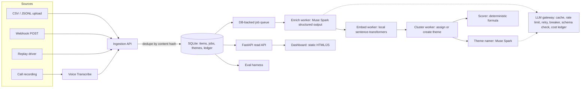

# CLAUDE.md: Signal build brief

You are building **Signal**, a solo entry in the **Meta Global AI Developer Hackathon**
(indie track). Read this whole file before doing anything. It is the source of truth for
product, architecture, API facts, rules and order of work. When this file and your own
instincts disagree, follow this file. When reality (the real API, the real data) disagrees
with this file, follow reality, record the difference in `PROGRESS.md`, and adapt.

---

## 0. Mission, deadline, non-negotiables

- **Hard deadline:** Nov 4, 2026, 9:00 PM ET = **Nov 5, 7:30 AM IST**.
  **Internal targets (IST):** feature freeze **Nov 4, 14:00**; demo video recorded by
  **Nov 4, 20:00**; submitted by **Nov 4, 23:00**. Work toward these, not the hard deadline.
- **Organiser requirements (from the official emails):**
  1. The GitHub repo **must be open source (public)**. This is mandatory.
  2. A **3-minute demo video** is critical to judging.
  3. The submission form has many questions, so draft the answers early (`docs/SUBMISSION.md`).
- **Indie track judging:** creativity, technical ambition, **whether it works**.
- **The builder's second goal matters as much as winning:** this project goes on a
  resume and gets explained in software-engineering interviews. It must show product
  thinking, clean system design (HLD + LLD), solid engineering practice and honest
  measurement. Optimise for "every design choice is deliberate and explainable", not for
  feature count.

---

## 1. Product brief

### One line
**Signal turns scattered customer feedback into a revenue-ranked list of what to fix next,
with the evidence behind every decision.**

### Problem
Every software company receives feedback through support tickets, social posts, app
reviews and sales or support calls. Product managers read a small sample by hand and
prioritise by gut feel and by whoever complained loudest. The costly failure mode is
fixing what many free users mention while a smaller group of high-revenue customers
quietly churns over something else.

### Users (personas)
- **Priya, product manager at a subscription software company.** Needs to answer "what
  should we fix next, and why?" with evidence she can show leadership.
- **Arjun, head of customer support.** Needs to see emerging problems before they become a
  ticket flood, and to show product which issues cost the most.
- **Buyer:** the VP of Product or Head of CX. Pays for fewer churned accounts and faster
  detection of problems.

### Jobs to be done
1. "When feedback piles up across channels, I want it grouped into themes automatically,
   so I stop reading thousands of messages by hand."
2. "When I decide what to fix, I want each theme ranked by revenue at risk and how fast
   it's growing, so I prioritise by impact, not volume."
3. "When I present a decision, I want the actual customer quotes behind it, so leadership
   trusts it."
4. "When a new problem starts spiking, I want to see it within hours, not at month-end."

### Positioning (honest)
This category exists: **Enterpret, Unwrap, BuildBetter, Thematic, SentiSum** sell it,
which validates that companies pay for it. **Do not claim novelty anywhere.** Signal's
angles:
- **Explainable ranking:** the priority score is a deterministic, documented formula,
  never an LLM opinion. Every number on screen can be traced to its inputs.
- **Evidence-linked:** every theme shows the quotes that formed it.
- **Measured:** published accuracy, cost per 1,000 items and latency from a real eval.
- **Replay mode:** feedback streams in over time, so the demo can show a theme emerging
  and climbing the ranking as it happens.

### Non-goals (do not build)
Ticket management, replying to customers, a CRM, auth/SSO, multi-tenant billing, Slack or
Jira integrations, mobile apps. These go under "Future work" in the README.

### Business model (hypothesis, label it as such)
SaaS priced per tracked feedback volume per month. Unit economics come from the **measured**
cost per 1,000 items, never an invented number.

### Success metrics (what the README reports, once measured)
- Enrichment accuracy (type, product area) on a human-labelled set
- Theme purity on a labelled subset
- Cost per 1,000 items, p50/p95 processing latency, throughput (items/min)
- Time to surface a spiking theme in replay mode

---

## 2. Data

### Primary: public "Customer Support on Twitter" dataset (Kaggle)
- Kaggle dataset `thoughtvector/customer-support-on-twitter`, file `twcs.csv`, about 3M
  tweets between customers and big brands' support accounts. The paper introducing it is
  arXiv:1809.00303.
- **Expected columns** (verify on load and fail with a clear message if they differ):
  `tweet_id, author_id, inbound, created_at, text, response_tweet_id, in_response_to_tweet_id`.
  `inbound=True` means a customer tweet. Brand accounts have handle-like `author_id`s
  (e.g. `SpotifyCares`). Customer ids are anonymised numbers.
- **Brand choice:** compute inbound volume per brand (customer tweets that mention the
  brand handle, or that are replied to by the brand's account). Default to **SpotifyCares**,
  a subscription software product with natural plan tiers. If it has fewer than ~5,000
  inbound tweets, pick the largest software or subscription brand instead and record why.
- **Licence:** check the licence on the Kaggle page and credit the dataset in the README.
  **Never commit raw tweets.** `data/raw/` is gitignored. The repo ships a prepare script,
  not the data.
- The human downloads `twcs.csv` into `data/raw/` (Kaggle needs a login). If it isn't
  there, don't block: use the synthetic dataset below and add the download to "Needs you".

### Simulated revenue (clearly labelled as simulated everywhere)
Tweets have no revenue. Generate a deterministic (seeded) **accounts** table: each
customer `author_id` gets a plan tier (e.g. Free / Individual / Family / Business) with
monthly revenue drawn from a documented distribution. The README and the UI footer must
say: "Revenue figures are simulated for demonstration; feedback text is real public data."

### Synthetic seed set (ships in the repo)
`data/sample/feedback_sample.jsonl`: about 300 synthetic feedback items written to look like
real support messages, across 6–8 planted themes, including one theme that spikes late in
the timeline. Generate it with a script (`scripts/make_sample.py`), seeded and
reproducible, and label it synthetic. Its purposes:
- the repo runs out of the box for judges, with no Kaggle download
- tests and CI
- a known ground truth for clustering tests (planted themes)

### Voice source
2–3 short mock "customer call" recordings (the human records them on a phone; English is
fine). Converted to WAV and transcribed with Voice Transcribe, each speaker turn becomes a
feedback item with `source=call`. If no recordings exist, the voice path is still built and
tested with a fixture, and recordings go on the "Needs you" list.

---

## 3. Verified API facts (Meta Model API docs, Oct–Nov 2026). Do not contradict these.

Base URL `https://api.meta.ai/v1`. Bearer key from the env var **`MODEL_API_KEY`**.
OpenAI Python SDK compatible (`OpenAI(base_url=..., api_key=...)`). Participants have $150 in
credits, but **a credit card must be on the account for calls to work** (organiser email).

### Muse Spark (`muse-spark-1.3`)
- Chat Completions supports **structured output**:
  `response_format={"type":"json_schema","json_schema":{"name":..., "strict": true, "schema": {...}}}`.
  Strict mode requires a plain-object root, `additionalProperties: false` on every object,
  every property listed in `required`, and no `allOf`/`oneOf`. Nesting ≤10 levels.
- Images: `{"type":"image_url","image_url":{"url":"data:image/jpeg;base64,..."}}`, ≤50 per request.
- Price: **$1.25 per 1M input tokens, $4.25 per 1M output tokens**; cached input $0.15/1M.
- Rate limits reported by third parties: about 3,000 requests/min and 4M tokens/min for
  standard Spark models. Treat these as unverified and build a client-side rate limiter anyway.
- `reasoning_effort` support is **unverified**. If it's rejected, retry without it.
- Confirm model ids with `client.models.list()` in Phase 0. Make the model id configurable
  (`SIGNAL_SPARK_MODEL`).

### Muse Voice Transcribe (`muse-voice-transcribe-1.0`)
- File endpoint: `POST https://api.meta.ai/v1/asr/transcribe`, `multipart/form-data` with
  two parts: **`request`** (JSON settings, same fields as the realtime handshake minus
  `authorization`) and **`audio`** (the WAV file). Auth via the `Authorization` header.
- Audio must be **RIFF/WAVE, mono, 16-bit PCM, 16 kHz or 24 kHz**. Convert with
  `ffmpeg -i in.m4a -ac 1 -ar 24000 -sample_fmt s16 out.wav`. Limits: body ≤32 MB, audio ≤10 min.
- Response: `sessionId`, `transcript`, `audioDurationMs`, `turns[]` with
  `turnId, startMs, endMs, transcript, speaker`. Turns are filled in `ENDPOINTING` and
  `DIARIZATION` modes; `speaker` only appears in `DIARIZATION`. **Timestamps are per turn,
  not per word.**
- **The exact JSON field names in `request` are NOT verified.** Before coding this, read
  https://dev.meta.ai/docs/speech-to-text and
  https://dev.meta.ai/docs/api-reference/voice/transcribe and follow them exactly.
- Price: $0.18 per audio hour.

### Not used
SAM 3.1 and Muse Image don't fit this product. Don't force them in; the reason is in ADR-001.

---

## 4. Architecture (HLD)



### Components
| Component | Responsibility |
|---|---|
| Ingestion API | Validate, normalise, dedupe (SHA-256 of normalised text + source + external id), persist, enqueue. Idempotent: re-posting the same item is a no-op that returns the existing id. |
| Job queue | Jobs table with `state`, `attempts`, `run_after`, `locked_by`, `locked_until`. Workers claim jobs atomically (`UPDATE ... WHERE state='queued' AND run_after<=now ... RETURNING`, or a transaction with row versioning). Lease expiry recovers jobs from crashed workers. After N failures a job goes to `dead`, the dead-letter state. |
| Enrich worker | One Muse Spark call per item (or a micro-batch of ≤20 items per call, measured both ways; record the decision in an ADR). Returns validated JSON (schema in §5). |
| Embed worker | Local `sentence-transformers/all-MiniLM-L6-v2` embedding of the item text (plus the key quote). Local because there's no verified Meta embeddings endpoint, it costs nothing, and it removes a network dependency. |
| Cluster worker | Online clustering. Assign the item to the nearest theme centroid if cosine ≥ τ, otherwise put it in an "unassigned" pool. Periodically re-cluster the pool (HDBSCAN or agglomerative from scikit-learn) to create new themes. Centroids update incrementally. |
| Theme namer | Muse Spark names and summarises each new or changed theme from a sample of its quotes. Only re-runs when membership changes by more than X%, to save money. |
| Scorer | The deterministic priority formula (§6). Stores the inputs alongside the score. |
| LLM gateway | The only path to any model: response cache keyed by (model, prompt hash, schema version), token-bucket rate limiter, retries with exponential backoff + jitter on 429/5xx/timeouts, circuit breaker, JSON-schema validation with one repair retry, cost and latency ledger, optional fallback model. |
| Read API | FastAPI: themes ranked, theme detail with evidence, item detail, metrics, replay controls. |
| Dashboard | Single static page, no build step. |
| Eval harness | Labelling tool + metric computation (§7). |

### Technology decisions (each gets an ADR in `docs/adr/`)
- **ADR-001: Scope of Meta models.** Spark for enrichment and theme naming, Voice
  Transcribe for calls. SAM and Muse Image are deliberately unused because they don't fit
  the problem.
- **ADR-002: SQLite (WAL mode) + SQLAlchemy** instead of Postgres. Single-file deployment
  and enough for this scale. Document the migration path: the repository layer isolates SQL.
- **ADR-003: DB-backed queue** instead of Redis/Celery. No extra infrastructure, and
  transactional enqueue with the insert (outbox-style). Document when you'd switch
  (throughput, multiple machines).
- **ADR-004: Local embeddings.** Cost, latency, determinism.
- **ADR-005: Online clustering with periodic re-clustering**, and why not batch-only.
- **ADR-006: Deterministic scoring.** Explainability and auditability. The LLM never ranks.
- **ADR-007: Per-item vs micro-batch enrichment.** Decided by measured cost and accuracy.

---

## 5. Low-level design

### Package layout (package name `signalhq`; **never `signal`**, which shadows the stdlib)
```
signalhq/
  config.py            # Settings (pydantic-settings or dataclass), all thresholds documented
  db.py                # engine, session, migrations bootstrap (create_all is fine)
  models.py            # SQLAlchemy ORM models
  repositories/        # ItemRepo, JobRepo, ThemeRepo, LedgerRepo (no SQL outside these)
  domain/
    states.py          # Item state machine + allowed transitions
    scoring.py         # pure functions, fully unit-tested
    schemas.py         # pydantic models + the JSON schemas sent to Spark
  connectors/          # Strategy pattern: base.Connector -> csv, jsonl, twcs, webhook, audio
  llm/
    gateway.py         # LLMGateway (cache, limiter, retry, breaker, validation, ledger)
    prompts.py         # versioned prompts (PROMPT_VERSION constants)
    voice.py           # Voice Transcribe client + WAV conversion
  pipeline/
    stage.py           # Stage protocol: name, handles(job_type), run(job) -> list[Job]
    enrich.py  embed.py  cluster.py  name_themes.py  score.py
  queue/worker.py      # claim -> run stage -> ack / retry with backoff / dead-letter
  api/app.py           # FastAPI routers
  web/static/          # index.html, app.js, styles.css
  replay.py            # replays a dataset in time order at N× speed
  eval/                # labelling CLI or page, metrics, report generator
  cli.py               # entry points (see §8)
tests/
scripts/
docs/adr/  docs/PRODUCT.md  docs/ARCHITECTURE.md  docs/DEMO_SCRIPT.md  docs/SUBMISSION.md  docs/RESUME.md
```

### Data model (tables)
- `accounts(id, external_ref, plan, mrr_cents, simulated BOOL)`
- `feedback_items(id, source, external_id, account_id, text, created_at, ingested_at,
   content_hash UNIQUE, state, error)`
- `enrichments(item_id PK, type, product_area, severity, sentiment, churn_signal BOOL,
   key_quote, language, model, prompt_version, raw_json, created_at)`
- `embeddings(item_id PK, model, dim, vector BLOB)`
- `themes(id, name, summary, centroid BLOB, size, status[active|merged|archived],
   created_at, updated_at, named_at_size)`
- `theme_members(theme_id, item_id, similarity, assigned_at)` PK(theme_id, item_id)
- `theme_scores(theme_id, computed_at, window_end, mentions_recent, mentions_prev, growth,
   revenue_at_risk_cents, severity_weight, score, inputs_json)`
- `jobs(id, type, payload_json, state[queued|running|done|failed|dead], attempts,
   max_attempts, run_after, locked_by, locked_until, last_error, created_at, updated_at)`
- `llm_calls(id, model, purpose, prompt_hash, cache_hit, input_tokens, output_tokens,
   cost_usd, latency_ms, status, error, created_at)`
- `eval_labels(item_id, type, product_area, theme_label, labeller, created_at)`

### Item state machine
`received → enriched → embedded → clustered`, with `failed` reachable from any state
(retryable) and `dead` after max attempts. Transitions are enforced in `domain/states.py`;
invalid transitions raise. Every stage is **idempotent**: rerunning a job for an item already
past that stage is a no-op.

### Enrichment schema (strict JSON schema for Spark)
```json
{
  "type": "object", "additionalProperties": false,
  "required": ["type","product_area","severity","sentiment","churn_signal","key_quote","language"],
  "properties": {
    "type": {"type":"string","enum":["bug","feature_request","usability","billing","performance","account_access","praise","question","other"]},
    "product_area": {"type":"string"},
    "severity": {"type":"string","enum":["low","medium","high","critical"]},
    "sentiment": {"type":"string","enum":["negative","neutral","positive"]},
    "churn_signal": {"type":"boolean"},
    "key_quote": {"type":"string"},
    "language": {"type":"string"}
  }
}
```
`product_area` is free text from Spark, normalised against a configurable taxonomy
(`config.PRODUCT_AREAS`) with a deterministic fuzzy match, falling back to "other". The
prompt tells Spark to copy `key_quote` verbatim from the input. The code **verifies that the
quote is a substring of the item text** and falls back to the first sentence if not. This
guards against made-up quotes.

### Key interfaces (Python Protocols)
```python
class Connector(Protocol):
    name: str
    def read(self, source: Path | bytes) -> Iterator[RawFeedback]: ...

class Stage(Protocol):
    job_type: str
    def run(self, job: Job, ctx: StageContext) -> list[NewJob]: ...   # returns follow-up jobs

class LLMGateway(Protocol):
    def structured(self, *, purpose: str, messages: list[dict], schema: dict,
                   schema_name: str) -> dict: ...
```

---

## 6. Priority scoring (deterministic, documented, unit-tested)

For each active theme over a sliding window (default: recent = last 7 days of data time,
previous = the 7 days before that; in replay, "now" is the replay clock):

- `mentions_recent`, `mentions_prev`: counts of member items in each window
- `growth = (mentions_recent + 1) / (mentions_prev + 1)` (smoothed)
- `revenue_at_risk = Σ mrr` over **distinct accounts** in the recent window whose item has
  `churn_signal = true` **or** severity ∈ {high, critical}
- `severity_weight = mean(map(severity))` with low=1, medium=2, high=3, critical=4
- `score = log1p(revenue_at_risk_dollars) × sqrt(growth) × severity_weight × log1p(mentions_recent)`

Store every input in `inputs_json`. The UI shows the formula and the inputs for each theme
("why is this ranked #1?"). All weights live in `config.py` with a comment each. Unit tests
cover edge cases: zero revenue, a new theme with no previous window, ties, one huge account.

---

## 7. Evaluation (honest numbers only)

- `python -m signalhq eval sample`: draws a stratified sample of 200 items (fixed seed)
  into `eval/to_label.csv`.
- `python -m signalhq eval label`: a minimal labelling UI (a page at `/label` or a terminal
  loop) for the **human** to label `type`, `product_area` and a free-text theme label.
  **Labels must come from the human, never from Spark** (that would be circular). Target
  about 150 labels in about 45 minutes; design the tool for speed (keyboard shortcuts).
- `python -m signalhq eval report` writes `eval/report.md` with:
  type accuracy + macro-F1, product-area accuracy, a confusion matrix, theme purity on
  labelled items, cost per 1,000 items (from `llm_calls`), p50/p95 latency per stage,
  throughput, cache hit rate, plus 5 worst errors with a short analysis.
- On the synthetic seed set, also report clustering recovery of the planted themes
  (adjusted Rand index), as a separate, clearly labelled "synthetic" table.
- Until a real report exists, the README says **"not yet measured"**.

---

## 8. CLI and API surface

```
python -m signalhq check                     # API key + model ids + one Spark call + DB ok
python -m signalhq init                      # create DB
python -m signalhq ingest <file> --connector twcs|csv|jsonl [--brand SpotifyCares] [--limit N]
python -m signalhq ingest-audio <file.m4a|wav>
python -m signalhq worker [--concurrency 4]  # run pipeline workers
python -m signalhq replay <file> --speed 3600 # 1 data-hour per real second
python -m signalhq serve                      # API + dashboard on :8000
python -m signalhq demo                       # one command: init + load sample + workers + serve
python -m signalhq eval sample|label|report
python -m signalhq stats                      # queue depth, dead jobs, spend so far
```
REST (FastAPI, OpenAPI docs at `/docs`):
`GET /api/themes?sort=score`, `GET /api/themes/{id}` (members, quotes, score inputs,
trend series), `GET /api/items/{id}`, `POST /api/feedback` (webhook ingest, idempotent),
`GET /api/metrics` (queue, cost, latency), `POST /api/replay/start|stop`.

---

## 9. Dashboard (single page, plain HTML/CSS/JS, no build step)

Layout:
1. **Header:** product name, data-source note ("Real public support tweets; revenue
   simulated"), replay clock and controls.
2. **KPI row:** items processed, active themes, total revenue at risk (simulated), cost so far.
3. **Ranked themes table:** rank, name, score, revenue at risk, mentions (recent vs previous,
   with a sparkline), growth arrow, top severity. A newly emerging theme gets a "new" badge.
4. **Theme detail panel:** summary, the formula with this theme's inputs filled in ("why
   ranked here"), the top quotes with source and plan tier, and the trend chart (Chart.js
   from cdnjs is allowed).
5. **Pipeline health:** queue depth by state, dead jobs, p95 latency, cache hit rate.

Must look clean at 1280 px and work at phone width. Light theme, readable, no decorative
effects. Verify with Playwright (headless Chromium) and save screenshots to
`docs/screenshots/` for the README.

---

## 10. Work plan (sprints with user stories and acceptance criteria)

Work strictly in order. Each story: build → tests → commit → one line in `PROGRESS.md`.
At the end of each sprint, write a 5-line retrospective in `PROGRESS.md` (what went well,
what didn't, what changes).

### Sprint 0: verify before building (about 45 min). Stop here if Spark is unreachable.
- **S0.1** `check` command: list models, one strict-JSON Spark call, print cost, report
  missing models. *AC:* if `MODEL_API_KEY` is set, it runs and its output is saved to
  `PROGRESS.md`. If Spark is unreachable, **stop and report** (likely cause: no card on
  the account).
- **S0.2** Read the Voice Transcribe docs, implement the client, and test it on a fixture
  WAV (generate a short tone/silence WAV to check request plumbing). If the human has
  provided a real recording in `data/audio/`, transcribe it. *AC:* a real response has been
  seen, or the reason it couldn't be is recorded.
- **S0.3** Dataset probe: if `data/raw/twcs.csv` exists, validate the columns, compute brand
  volumes, choose the brand, and record counts. Otherwise use synthetic and add the
  download to "Needs you".
- **S0.4** `docs/PRODUCT.md` (from §1) and `docs/BACKLOG.md` (these stories with MoSCoW tags).

### Sprint 1: core pipeline (target: Nov 4, 03:00 IST)
- **S1.1 (Must)** Project skeleton, config, DB models, repositories, state machine. Tests
  for the state machine.
- **S1.2 (Must)** Connectors: jsonl/csv/twcs + dedupe. *AC:* ingesting the same file twice
  creates zero new rows (test).
- **S1.3 (Must)** Job queue + worker: atomic claim, lease expiry, retry with backoff,
  dead-letter. *AC:* tests for crash recovery (expired lease is reclaimed), max-attempt
  dead-lettering, and no double processing with 2 concurrent workers.
- **S1.4 (Must)** LLM gateway: cache, token bucket, retry/backoff, breaker, schema
  validation + one repair retry, ledger. *AC:* tests using a fake transport for 429s,
  timeouts, invalid JSON and cache hits.
- **S1.5 (Must)** Enrich stage with quote verification. Run on 50 real items and inspect.
- **S1.6 (Must)** Synthetic seed generator + `demo` command running end to end offline,
  using a fake LLM transport when no key is set (clearly marked "offline demo mode").

### Sprint 2: intelligence + API (target: Nov 4, 10:00 IST)
- **S2.1 (Must)** Embeddings + online clustering + periodic re-cluster. *AC:* recovers the
  planted themes in the synthetic set (report ARI) and the threshold τ is justified in an ADR.
- **S2.2 (Must)** Theme naming with change-threshold re-naming.
- **S2.3 (Must)** Deterministic scoring + unit tests (§6).
- **S2.4 (Must)** FastAPI read API + webhook ingest (idempotent).
- **S2.5 (Should)** Replay driver.
- **S2.6 (Should)** Voice ingestion path (`ingest-audio`), speaker turns → items with `source=call`.

### Sprint 3: product surface + proof (target: feature freeze Nov 4, 14:00 IST)
- **S3.1 (Must)** Dashboard (§9) + Playwright screenshots.
- **S3.2 (Must)** Eval tooling (§7). The human labels; then `eval report`.
- **S3.3 (Must)** Real run: ingest about 3,000–10,000 items of the chosen brand within the
  budget, process them, and record the measured throughput, cost and latency.
- **S3.4 (Should)** `/api/metrics` + pipeline health panel.
- **S3.5 (Could)** Docker file and a GitHub Actions workflow running the tests.

### Sprint 4: submission pack (Nov 4, 14:00–20:00 IST)
- `README.md`: the problem in 3 lines, a GIF or screenshot, quickstart (`demo` works with no
  key and no Kaggle data), architecture (Mermaid HLD), the LLD summary, ADR index, measured
  results table, honest limits, future work, dataset credit, the "revenue simulated" note.
- `docs/ARCHITECTURE.md`: HLD + LLD + sequence diagram for one item's journey + failure
  handling (what happens on 429, a worker crash, invalid JSON, duplicate input).
- `docs/DEMO_SCRIPT.md` (3:00 total):
  0:00–0:20 the problem (feedback everywhere, prioritised by gut);
  0:20–1:40 replay: watch themes form, a theme spike and climb the ranking, open it and
  show the quotes and "why ranked here";
  1:40–2:20 architecture in one diagram: queue, gateway, deterministic scoring, and where
  Muse Spark and Voice Transcribe fit;
  2:20–2:50 measured results (accuracy, cost per 1,000, latency);
  2:50–3:00 limits and what's next.
- `docs/SUBMISSION.md`: draft answers (one-liner, problem, solution, Meta models used and
  how, technical challenges, what's novel *in the approach* (not "first ever"), what's
  next, links), all consistent with the code and measured numbers.
- `docs/RESUME.md`: 3 resume bullets with real numbers, plus interview talking points: the
  design decisions, the trade-offs rejected, what you'd change at 100× scale.
- Final check: fresh virtualenv → `pip install -r requirements.txt` → tests pass →
  `python -m signalhq demo` works with **no API key and no Kaggle data**.

### Cut order if behind (cut from the top)
Docker/CI → voice path (keep it in the README as designed) → metrics panel → replay
(demo with a static dataset instead) → theme re-naming threshold (name once).
**Never cut:** dedupe/idempotency, the queue's retry/dead-letter, the gateway, deterministic
scoring, evidence quotes, eval with real labels, the README.

---

## 11. Non-negotiable rules

1. **Never fabricate numbers.** No invented accuracy, costs, latencies, user counts, market
   sizes or customer quotes in code, README, UI or submission. Metrics come only from
   `eval report` and the ledger. Until measured: "not yet measured".
2. **Simulated data is always labelled simulated.** Revenue is simulated, the sample set is
   synthetic, and both say so in the UI and README.
3. **Never commit secrets or raw tweets.** Key only in env or an untracked `.env`.
   `data/raw/`, `*.db` and `.env` are gitignored.
4. **Every model call goes through the LLM gateway and its cache.** Budget cap: stop and
   report if estimated spend in a session would exceed **$15**. Use `stats` to check.
5. **The LLM never decides the ranking.** It extracts and names; deterministic code scores.
6. **Tests stay green.** `pytest -q` before every commit. New logic gets tests. Unit tests
   never call the real API; use the fake transport. Mark real-API tests `@pytest.mark.live`
   and skip them by default.
7. **Small, frequent commits** with clear messages (conventional style: `feat:`, `fix:`,
   `test:`, `docs:`). Commit locally. Push only if the user has configured a remote and
   asked you to.
8. **Don't widen scope.** If it isn't in §10, it goes under "Future work".
9. **Python 3.10+, type hints, small functions, docstrings where intent isn't obvious.**
   Allowed dependencies: fastapi, uvicorn, sqlalchemy, pydantic, pydantic-settings, openai,
   httpx, sentence-transformers, scikit-learn, numpy, pandas, python-multipart, pytest,
   playwright (dev). Add others only with a reason recorded in an ADR.
10. **User-facing text:** plain sentence case, no hype words, no emoji.

---

## 12. Things only the human can do (collect them; never block on them)

- Add a **credit card** in the Meta Model API billing page (required even with credits),
  set a spend-limit alert, and export `MODEL_API_KEY`.
- Download `twcs.csv` from Kaggle into `data/raw/`.
- Record 2–3 short mock customer calls (30–60 s each) into `data/audio/`.
- Label about 150 items with the labelling tool (about 45 min).
- Make the GitHub repo **public**, record the 3-minute demo video, and submit.

Keep these in a **"Needs you"** list at the top of `PROGRESS.md`, ordered by when they're
needed, and repeat them in your final message. Continue with everything that doesn't
depend on them.

## 13. When to stop and report

Stop and summarise (done / verified against the real API / unverified / "Needs you") when:
- Sprint 0 shows Spark is unreachable, or
- everything you can do without the human is done, or
- the same failure persists after 3 genuinely different fix attempts, or
- spend would exceed the budget, or
- the real API contradicts §3 in a way that changes the design (adapt, record, and report).
