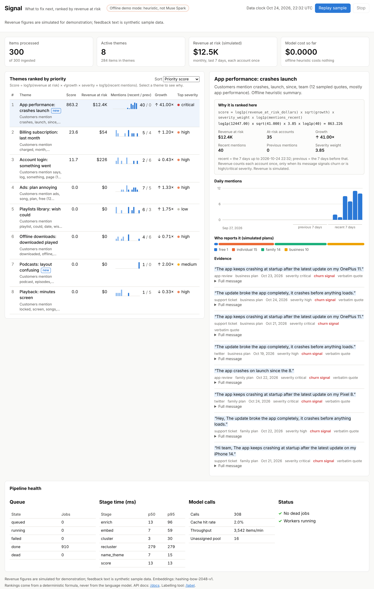
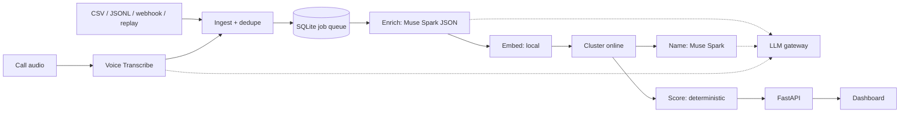

# Signal

**Signal turns scattered customer feedback into a revenue-ranked list of what to fix next,
with the evidence behind every decision.**

Feedback arrives through tickets, social posts, reviews and calls. Product teams read a small
sample and prioritise by gut feel or by whoever complained loudest. The expensive mistake is
fixing what many free users mention while a smaller group of paying customers quietly churns
over something else. Signal groups feedback into themes with Muse Spark, ranks the themes with
a deterministic, explainable formula driven by revenue at risk and growth, and shows the
verbatim quotes behind every theme.

> Revenue figures are simulated for demonstration; feedback text is real public data (Kaggle
> "Customer Support on Twitter") when you load it, and synthetic in the bundled sample.



Built solo for the Meta Global AI Developer Hackathon (indie track).

## Quickstart (no API key, no Kaggle download)

```bash
python -m venv .venv
```
```bash
source .venv/bin/activate
```
```bash
pip install -r requirements.txt
```
```bash
python -m signalhq demo
```

Open http://127.0.0.1:8000. The demo loads 300 **synthetic** feedback items, processes them and
serves the dashboard. With no `MODEL_API_KEY` it runs in **offline demo mode**: a keyword
heuristic stands in for Muse Spark (model id `offline-heuristic-v1`, shown in the header) so the
whole pipeline, including the gateway, cache, queue and scoring, runs without a network.

Watch a theme emerge and climb the ranking, replaying the sample over about 90 seconds:

```bash
python -m signalhq demo --replay
```

(or press **Replay sample** in the dashboard).

## With Muse Spark and real data

```bash
export MODEL_API_KEY=...        # a credit card must be on the Meta Model API account
```
```bash
python -m signalhq check        # lists models, one strict-JSON Spark call, prints its cost
```
```bash
python scripts/probe_twcs.py    # after downloading twcs.csv into data/raw/
```
```bash
python -m signalhq --db signal-real.db ingest data/raw/twcs.csv --connector twcs --brand SpotifyCares --limit 5000
```
```bash
python -m signalhq --db signal-real.db worker --drain --concurrency 8
```
```bash
python -m signalhq --db signal-real.db serve
```

Spend is capped at $15 per database by default (`SIGNAL_BUDGET_USD`); `python -m signalhq stats`
shows queue depth, dead jobs and spend so far. Call recordings: `python -m signalhq ingest-audio
call.m4a` (converted to 24 kHz mono WAV with ffmpeg, transcribed by Voice Transcribe, one item
per speaker turn).

## Troubleshooting

| You see | What to do |
|---|---|
| Billing page: "No payment method on file" | Add a card under Billing. It is required even while you use the free credits, and the balance does not grow while credits last. |
| `check` prints "Spark is not reachable with this key" | Follow the list it prints: payment method, then key, then model id (Models page), then network. |
| Header says "Offline demo mode" | `MODEL_API_KEY` is not set in the shell that runs Signal. Export it and restart. |
| "STOPPED: spend would exceed the $15.00 budget" | The budget cap worked. Check `python -m signalhq stats`, then raise `SIGNAL_BUDGET_USD` only if you mean to. |
| Dead jobs in the health panel | `python -m signalhq stats` shows the errors; `python -m signalhq requeue-dead` retries them. |
| `ingest --connector twcs` loads few items | Run `python scripts/probe_twcs.py` and pick a brand with more traffic via `--brand`. |

## How it works



1. **Ingest.** Connectors (jsonl, csv, Kaggle twcs, webhook, call audio) produce feedback
   items. A SHA-256 content hash makes ingestion idempotent; the item and its first job are
   written in one transaction.
2. **Enrich.** One Muse Spark call per item with a strict JSON schema: type, product area,
   severity, sentiment, churn signal, key quote, language. The key quote must appear verbatim
   in the message or it is replaced by the first sentence. Product areas are normalised
   against a fixed taxonomy.
3. **Embed and cluster.** Local embeddings (MiniLM when installed, a deterministic hashing
   embedder otherwise). Each item joins the nearest theme above a threshold or waits in a
   pool; the pool is re-clustered periodically into new themes; near-duplicate themes merge.
4. **Name.** Muse Spark names and summarises each theme from its most typical quotes, and
   renames only after the theme grows by 50%.
5. **Score.** A pure function, never the model:
   `score = log1p(revenue at risk $) × √growth × severity weight × log1p(recent mentions)`,
   over 7-day windows of data time. Every input is stored and shown ("why ranked here").

Every model call goes through one **LLM gateway**: response cache, token-bucket rate limiter,
retries with jittered backoff, circuit breaker, schema validation with one repair attempt,
cost and latency ledger, and a hard budget cap. The **job queue** lives in SQLite: atomic
claims, leases, fencing tokens, retries with backoff and a dead-letter state.

Details: [docs/ARCHITECTURE.md](docs/ARCHITECTURE.md) (HLD, LLD, one item's journey, failure
handling). Product brief: [docs/PRODUCT.md](docs/PRODUCT.md).

### Design decisions

| ADR | Decision |
|---|---|
| [001](docs/adr/ADR-001-meta-models.md) | Muse Spark for enrichment and naming, Voice Transcribe for calls; SAM and Muse Image deliberately unused |
| [002](docs/adr/ADR-002-sqlite.md) | SQLite (WAL) + SQLAlchemy; all SQL behind repositories; Postgres migration path |
| [003](docs/adr/ADR-003-db-queue.md) | Database-backed queue with transactional enqueue instead of Redis/Celery |
| [004](docs/adr/ADR-004-local-embeddings.md) | Local embeddings: no cost, no network, deterministic |
| [005](docs/adr/ADR-005-online-clustering.md) | Online assignment + periodic re-clustering; thresholds from a measured sweep |
| [006](docs/adr/ADR-006-deterministic-scoring.md) | Deterministic, documented scoring; the LLM never ranks |
| [007](docs/adr/ADR-007-enrichment-batching.md) | Per-item enrichment until micro-batching is measured |

## Results

**With Muse Spark on real data: not yet measured.** The build environment had no API key and
no network access to the Meta Model API, so enrichment accuracy, cost per 1,000 items and model
latency have not been measured yet. They will come only from `python -m signalhq eval report`
after a real run and human labels (see `PROGRESS.md`, "Needs you").

What has been measured, on the **synthetic** sample in **offline demo mode** (heuristic
enricher, hashing embedder). These numbers show the pipeline works; they say nothing about
Muse Spark's accuracy.

| Measurement (synthetic data, offline mode) | Value | Source |
|---|---|---|
| Theme recovery, adjusted Rand index vs 8 planted themes | 0.987 (8 of 8 themes found) | `eval/report-offline-synthetic.md` |
| Mean ARI across four re-cluster cadences (threshold sweep) | 0.977 (worst 0.955) | `scripts/tune_clustering.py`, ADR-005 |
| Planted spike reaches rank 1 in replay | after 12–15 of its 40 messages (3 runs) | `scripts/measure_replay.py` |
| Re-ingesting the same file | 0 new rows | `tests/test_connectors.py` |
| Concurrent workers, 60 jobs | each processed exactly once | `tests/test_queue.py` |
| Test suite | 128 tests, no network, no key | `pytest` |

The loudest planted theme (ads, 55 messages) comes almost entirely from free accounts, so it
ranks below the smaller crash spike from paying accounts: the behaviour the score is designed for.

## Honest limits

- **Unverified against the real API:** Spark structured output, `reasoning_effort` support
  (dropped automatically if rejected) and the Voice Transcribe `request` field names
  (`signalhq/llm/voice.py`, marked UNVERIFIED).
- **Revenue is simulated:** a seeded plan tier per customer id (55% free, 25% individual
  $10, 12% family $17, 8% business $12 per seat × 2–250 seats). A real deployment would join
  billing or CRM data.
- **Hashing embedder:** the offline fallback does not understand paraphrase. The product-area
  anchor helps, but on the synthetic set it is flattered because the heuristic and the
  templates share vocabulary. MiniLM thresholds are starting values, not measured.
- **Single process, single SQLite writer:** fine for thousands of items per minute in one
  process; see ADR-002/003 for the path beyond.
- **Order dependence:** online clustering results vary slightly with arrival order and worker
  timing.
- The Dockerfile was written but not built in the build environment (no Docker daemon).

## Future work

Ticket management, replying to customers, CRM and billing integration for real revenue,
auth/SSO, multi-tenant billing, Slack/Jira integrations, mobile apps, Postgres + a broker for
multi-machine workers, screenshot attachments through Spark's image input, per-area
re-clustering and an ANN index at larger scale.

## Repository guide

| Path | What |
|---|---|
| `signalhq/` | The application (see ARCHITECTURE.md for the layout) |
| `tests/` | Unit and integration tests; real-API tests would be marked `@pytest.mark.live` and are skipped by default |
| `scripts/make_sample.py` | Generates the synthetic seed set (seeded, reproducible) |
| `scripts/tune_clustering.py` | Threshold sweep (ARI on planted themes) |
| `scripts/measure_replay.py` | Time-to-surface of the planted spike in replay |
| `scripts/compare_batching.py` | ADR-007 measurement (needs a key) |
| `scripts/probe_twcs.py` | Dataset probe and brand volumes |
| `scripts/screenshots.py` | Playwright screenshots for this README |
| `docs/` | Product brief, architecture, ADRs, backlog, demo script, submission and resume drafts |
| `PROGRESS.md` | Build log, retrospectives and the "Needs you" list |

CLI: `python -m signalhq check | init | ingest | ingest-audio | worker | replay | serve | demo |
eval sample|label|report | stats | requeue-dead`. REST API with OpenAPI docs at `/docs`.

Tests: `pip install -r requirements.txt` then `python -m pytest`. CI runs the suite, the
offline demo and the eval report on Python 3.11–3.13 (`.github/workflows/tests.yml`).

## Data and credits

- Real data: Kaggle dataset `thoughtvector/customer-support-on-twitter` (`twcs.csv`),
  introduced in arXiv:1809.00303. Check the licence on the Kaggle page before use. Raw tweets
  are never committed; `data/raw/` is git-ignored and the repo ships only the connector.
- The bundled `data/sample/feedback_sample.jsonl` is synthetic, written by
  `scripts/make_sample.py`.
- Similar products exist (Enterpret, Unwrap, BuildBetter, Thematic, SentiSum). Signal does not
  claim novelty; its angles are an explainable ranking, verbatim evidence, honest measurement
  and a replay mode.

## Licence

MIT, see [LICENSE](LICENSE).
