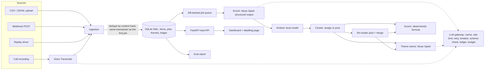

# Architecture

Signal is one Python process (FastAPI + worker threads) over one SQLite file. This page
covers the high-level design, the low-level design, one item's journey, and what happens
when things fail. Decisions and their trade-offs are in [`docs/adr/`](adr/README.md).

## High-level design



| Component | Code | Responsibility |
|---|---|---|
| Connectors | `signalhq/connectors/` | Strategy pattern: jsonl, csv, twcs (Kaggle tweets), webhook, audio turns -> `RawFeedback` |
| Ingestion | `signalhq/ingest.py` | SHA-256 of normalised text + source + external id; insert-or-ignore; enqueue `enrich` in the same transaction |
| Queue + worker | `repositories/jobs.py`, `queue/worker.py` | Atomic claim, leases, fencing, backoff, dead-letter, dedupe keys, worker threads |
| Stages | `signalhq/pipeline/` | enrich, embed, cluster, recluster, name_theme, score; each idempotent |
| LLM gateway | `signalhq/llm/gateway.py` | The only path to a model |
| Scoring | `signalhq/domain/scoring.py` | Pure functions, fully unit-tested |
| Read API | `signalhq/api/` | Ranked themes, theme detail with evidence and score inputs, metrics, webhook, replay, labels |
| Dashboard | `signalhq/web/static/` | Static HTML/CSS/JS, no build step |
| Eval | `signalhq/eval/` | Stratified sample, labelling queue, report |

## Low-level design

### Package layout
```
signalhq/
  config.py            settings + every threshold, each commented
  db.py                engine, deferred read / BEGIN IMMEDIATE write sessions
  models.py            ORM tables (§5 of the brief plus documented additions)
  accounts.py          deterministic simulated plans and MRR
  repositories/        ItemRepo, JobRepo, ThemeRepo, LedgerRepo, AccountRepo, EvalRepo, KVRepo (all SQL)
  domain/              states.py, scoring.py, schemas.py, taxonomy.py, clustering.py (pure)
  connectors/          base.py, files.py (jsonl/csv), twcs.py, webhook.py, audio.py
  llm/                 gateway.py, transport.py, offline.py, resilience.py, validation.py, prompts.py, voice.py
  pipeline/            stage.py, enrich.py, embed.py, cluster.py, name_themes.py, score.py
  queue/worker.py      Worker, WorkerPool, drain
  api/                 app.py (routes), views.py (response assembly)
  replay.py            ReplayDriver, ReplayController
  eval/                labelling.py, report.py, commands.py
  runtime.py, cli.py
```

### Key interfaces
```python
class Connector(Protocol):
    name: str
    def read(self, source: Path | bytes) -> Iterator[RawFeedback]: ...

class Stage(Protocol):
    job_type: str
    def run(self, job: ClaimedJob, ctx: StageContext) -> list[NewJob]: ...  # follow-ups

class ChatTransport(Protocol):            # behind the gateway
    name: str; billable: bool
    def complete(self, request: ChatRequest, timeout_s: float) -> ChatResult: ...

LLMGateway.structured(*, purpose, messages, schema, schema_name, schema_version, max_tokens) -> dict
```

### Tables
`accounts`, `feedback_items`, `enrichments`, `embeddings`, `themes`, `theme_members`,
`theme_scores`, `jobs`, `llm_calls`, `llm_cache`, `eval_labels`, `kv`. Additions beyond the
brief, each with its reason, are listed at the top of `signalhq/models.py`.

### Item state machine
`received -> enriched -> embedded -> clustered`; `failed` from any non-terminal state
(retryable, the retried stage moves it forward); `dead` after max attempts or a permanent
error; `dead -> received` only by an operator. Same-state transitions are no-ops; anything
else raises `InvalidTransition`. Pool items (embedded, not yet in a theme) stay `embedded`.

## One item's journey

```mermaid
sequenceDiagram
  participant C as Connector / webhook
  participant I as Ingestion
  participant DB as SQLite
  participant W as Worker
  participant G as LLM gateway
  participant S as Muse Spark
  C->>I: RawFeedback(text, source, external_id, account_ref, created_at)
  I->>DB: BEGIN IMMEDIATE; upsert account; INSERT item ON CONFLICT(content_hash) DO NOTHING; INSERT job enrich; COMMIT
  W->>DB: claim: UPDATE jobs ... RETURNING (lease 600 s, attempts+1)
  W->>G: structured(enrich prompt, strict schema)
  G->>DB: cache lookup (model, prompt hash, schema version)
  G->>S: chat.completions (json_schema, strict) after budget, rate limit, breaker
  S-->>G: JSON
  G->>G: validate; one repair round-trip if invalid
  G->>DB: ledger row (tokens, cost, latency); cache put
  W->>DB: save enrichment (quote verified, area normalised); state enriched
  W->>DB: ack (fenced) + enqueue embed, one transaction
  W->>W: embed locally; save vector; ack + enqueue cluster
  W->>DB: BEGIN IMMEDIATE: nearest centroid >= tau ? add member + update centroid : leave in pool
  W->>DB: ack + enqueue score (deduped) and maybe name_theme / recluster
  W->>DB: score: compute_score for every active theme; insert changed scores
```

## Failure handling

| Failure | What happens | Where |
|---|---|---|
| **429 / 5xx / timeout** | Gateway retries up to 4 times with full-jitter exponential backoff, never sooner than Retry-After; each attempt is a ledger row. If it still fails, the job goes to `failed` with job-level backoff and is retried up to 5 attempts, then `dead`. | `llm/gateway.py`, `queue/worker.py` |
| **API unhealthy** | After 5 consecutive transient failures the breaker opens for 30 s; calls fail fast (no network), jobs back off; one trial call decides whether to close. | `llm/resilience.py` |
| **Invalid JSON / schema mismatch** | One repair round-trip that shows the model its answer and the validation errors. If still invalid, the job is retried later; the bad answer is never cached. | `llm/gateway.py` |
| **Made-up quote** | The key quote must appear verbatim (case and whitespace tolerant) in the text; otherwise the first sentence is used and `quote_verified=false` is stored and shown. | `domain/taxonomy.py` |
| **Unsupported parameter** (e.g. `reasoning_effort`) | The transport drops it, remembers that, and retries without it. | `llm/transport.py` |
| **Permanent error** (400/401/403/404, validation) | No retries; job and item go to `dead` with the error stored. `stats` lists dead jobs; `requeue-dead` retries them. | `queue/worker.py` |
| **Budget cap** ($15 by default) | The gateway refuses any call that would exceed it; the worker returns the job to the queue unchanged and all workers stop with a clear message. | `llm/gateway.py`, `queue/worker.py` |
| **Worker crash** | The job's lease expires and another worker reclaims it. If the crash came after the stage wrote its result, the stage sees the stored result and only re-emits follow-ups. A crash on the final attempt is reaped to `dead`. | `repositories/jobs.py` |
| **Slow worker loses its lease** | Its ack is rejected by the fencing check (`locked_by` + `attempts`), so its follow-ups are discarded and the new owner's result stands. | `repositories/jobs.py` |
| **Duplicate input** | Same normalised text + source + external id gives the same content hash: no new row, no new job, the existing id is returned (webhook answers 200 instead of 201). | `ingest.py` |
| **Concurrent clustering** | Cluster and re-cluster run under `BEGIN IMMEDIATE`, so centroid read-modify-write cycles are serialised. | `pipeline/cluster.py` |
| **Replay reset** | Deletes items and derived rows; keeps the model cache (re-runs cost nothing), the ledger and human labels (re-linked by content hash). | `replay.py` |

## Scaling notes (what changes at 100x)
- **Storage and queue:** Postgres with `FOR UPDATE SKIP LOCKED`, then a broker if workers
  span machines (ADR-002, ADR-003).
- **Enrichment:** the dominant cost; micro-batching (ADR-007) and the cache; route
  low-value items (praise, duplicates) to a cheaper path.
- **Clustering:** an approximate nearest-neighbour index for assignment, and re-clustering
  per product area so the O(n^2) step stays small.
- **Scoring:** incremental per theme instead of all themes per run.
- **Multi-tenancy, auth, real revenue from billing/CRM:** out of scope here (README,
  Future work).
